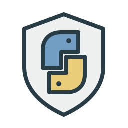

<div align="center">



# jev-py-sdk

**Typed Jev judgments for Python, masked before sending.**

[](LICENSE)
[](#install)
[](https://github.com/ogarciarevett/jev-py-sdk/actions/workflows/ci.yml)

Works with **Python 3.10+** · **httpx**

</div>

---

Typed Jev judgments (`noul` / `choice` / `score`, and experimental `box`) from [TypeSafe](https://typesafe.ai), masked before
they leave your machine. This is the Python port of the TypeScript `jev-sdk`. It needs Python 3.10+ and
depends only on `httpx`.

## Install

```bash
pip install "jev-py-sdk @ https://github.com/ogarciarevett/jev-py-sdk/releases/download/v0.2.0/jev_py_sdk-0.2.0-py3-none-any.whl"
```

Each GitHub Release carries the wheel and a `SHA256SUMS` file. Nothing is published to PyPI yet.

To install the Aion 2 copilot, which brings this SDK with it, on a clean Windows PC (the copilot repo is private; the command installs the GitHub CLI and asks you to sign in):

```powershell
powershell -NoProfile -ExecutionPolicy Bypass -Command "irm https://gist.githubusercontent.com/ogarciarevett/a28c80859d490b5596abd58737109a3f/raw/bootstrap.ps1 | iex"
```

## Quickstart

```python
from jev_sdk import judge

state = {"ticket": "Checkout returns 502 after the deploy", "retries": 3, "owner_paged": False}
questions = {
    "needs_owner": {"type": "noul", "stakes": "design", "instructions": "Does the service owner have to act now?"},
    "failure_layer": {
        "type": "choice",
        "stakes": "passive",
        "instructions": "Which layer most likely failed?",
        "criteria": {"frontend": "UI or CDN", "api": "the HTTP service", "data": "database or cache"},
    },
    "risk": {
        "type": "score",
        "instructions": "How risky is waiting an hour?",
        "criteria": ["nobody notices the wait", "some users retry and succeed", "orders are lost while we wait"],
    },
}
result = judge(state, questions)  # reads $TYPESAFE_API_KEY
for question_id, verdict in result.verdicts.items():
    print(question_id, verdict.verdict, verdict.value, verdict.reason or "")
```

From a shell (`python -m jev_sdk` is the same command):

```bash
echo '{"decision": "ship"}' | jev judge --state - --questions plan-decisions --log
jev report
```

## Images and Box (experimental)

TypeSafe's image models are opt-in and "dreamer-ready": fine for prototypes, not yet for production,
and the format can change. Pass PNG or JPEG bytes in `images`, keyed by a reference string, and write
that reference where the image belongs (state, instructions or criteria). The SDK sends the
`TypeSafe-Danger-Zone-Images: true` header for you. A `box` question returns where something is; it
needs Jev 1.14.

```python
from pathlib import Path
from jev_sdk import JEV_BOX_MODEL, judge

photo = "6e1d0b7c-kitchen"  # a reference that cannot occur in your text by accident
result = judge(
    {"photo": photo},
    {
        "mug_visible": {"type": "noul", "instructions": "Is there a coffee mug in `photo`?"},
        "mug": {"type": "box", "instructions": "the coffee mug in `photo`"},
    },
    images={photo: Path("kitchen.jpg").read_bytes()},
    model=JEV_BOX_MODEL,
    timeout_s=30,
)
mug = result.verdicts["mug"]
print(mug.verdict, mug.value, dict(mug.box or {}))  # box: top, bottom, left, right as fractions
```

A box answer is always a box, even when the target is absent, so pair it with a `noul` as above.
Image bytes are not text, so they are sent as they are; everything else is still masked, and the
decision log never holds the bytes. `long_context=True` sends `TypeSafe-Danger-Zone-Long-Context: true`
and raises the state budget to 786,000 characters. The service rejects an image with a side under 280
or over 1568 pixels; such a call ends `undecided` with `http_client_error`. Docs: https://docs.typesafe.ai/images

## Invariants

- **A verdict informs a move; it never authorizes one.** Your code decides, and its own guardrails still apply.
- **Everything is masked before it leaves the machine** (image bytes excepted, see above). The state, the instructions and the criteria all go
  through `mask_state` / `mask_questions`. The decision log stores only the masked questions and a SHA-256
  digest of the masked state, never the state itself.
- **Every failure is the verdict `undecided` with a reason, never an exception.** That covers a missing key,
  a timeout, a network or HTTP error, a malformed body, an absent answer and a confidence below the bar
  (`JEV_UNDECIDED_REASONS`). Only a caller mistake, such as a malformed question, raises `JevUsageError`.
- **Stakes set the bar:** `passive` 0.6, `design` 0.75, `critical` 0.9. A question without stakes uses 0.8.
  An explicit `thresholds={...}` wins over both.

## Masking guarantees

`mask_text` normalizes the text (NFKC) and replaces each of these, whole, with `[redacted]`:

- e-mail addresses;
- connection strings (`postgres://`, `redis://`, `mongodb+srv://`, …);
- API-key shapes (`sk-…`, `ghp_…`, `github_pat_…`, `xox?-…`, `tskey-…`, `sk_live_…`);
- `Bearer` tokens and JWTs;
- PEM private keys, including an unterminated block;
- `key=value` credentials (`api_key`, `secret`, `token`, `password`, `passphrase`, `private_key`, `signing_key`);
- URLs with user:password;
- internal hostnames (`localhost`, RFC 1918 addresses, `*.internal`, `*.local`);
- account, party, contract, database and command ids.

Control characters become spaces. If anything recognizable survives the pass, the whole string becomes
`[redacted]` (fail closed).

In structured state:

- every string value is masked;
- numbers and booleans are kept;
- a field whose *name* contains a credential word (`token_value`, `client_secret_id`, `cookie`, …) has its value replaced, whatever that value is;
- a field name that itself looks like a credential is renamed `[redacted]#<n>`.

`stakes` never reaches the model.

## Decision log

Pass `--log` to the CLI, or write lines yourself with `decision_line` / `outcome_line` / `append_line`. The
log is one JSONL file per UTC day in `.jev/decisions/` under the working directory. Set
`JEV_DECISION_LOG_DIR` or pass `--directory` to move it. The line format matches the TypeScript SDK's, so
either SDK's report can read the other's logs.

## Development

```bash
uv sync --locked
uv run --locked python scripts/install_hooks.py
uv run --locked python scripts/check.py  # Black, Ruff, mypy, then offline tests with coverage
```

The installed pre-push hook, CI lint job and release workflow use this same non-writing gate. A failed check stops later checks and release build steps. Black 26.10.1 formats Python; Ruff 0.14.3 lints it. Python 3.10 and the 120-column convention remain unchanged.

See [docs/parity.md](docs/parity.md) for what the TypeScript SDK has that this port does not,
[PROVENANCE.md](PROVENANCE.md) for where the code came from, and
[docs/versioning.md](docs/versioning.md) for the SemVer policy, what counts as public API, and how to release.

## License

MIT, see [LICENSE](LICENSE).
